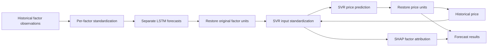

# Jining coal price prediction

**Project report**  
**Author: WeiweiDeng**

## Abstract

This project implements a two-stage coal price forecasting pipeline for Jining, Shandong. Separate LSTM models forecast explanatory variables over weekly, monthly, and annual horizons; a support vector regression (SVR) model combines those forecasts with a recursively updated historical-price input. SHAP analysis describes how the SVR responds to its inputs, and a Flask API exposes asynchronous forecasting tasks.

The repository contains historical data, pretrained artifacts, training scripts, and an inference service. This report describes that implementation and evaluates the strength of the evidence already available. Recorded monthly results can be reproduced arithmetically from an existing prediction log and the supplied data, but the current experiment design has overlapping training and evaluation targets. The annual evaluation records a negative R². An inherited SVR summary is inconsistent with the current target-price range. These observations support a working research prototype, rather than a demonstrated production forecasting system.

No model was retrained to prepare this report. File-integrity and API tests establish software properties, not forecasting accuracy.

## 1. Objective and scope

The target is the CCI Jining gas coal price in CNY per metric tonne. The implementation provides forecasts for the next 7, 30, or 365 days, together with predicted factors and feature-attribution information.

The project addresses three engineering questions:

1. How can future explanatory variables be estimated when their future observations are unavailable?
2. How can those estimates be combined with recent price information to generate a price trajectory?
3. How can predictions and explanations be delivered through an inspectable API?

The repository does not establish a causal model of coal prices, a trading strategy, calibrated prediction intervals, or a guaranteed forecast accuracy.

## 2. Data and artifacts

The dataset is [data/cci_jining_coal.csv](data/cci_jining_coal.csv). Its contents are preserved as supplied.

| Property | Observed value |
| --- | --- |
| Recorded date range | January 1, 2021–December 31, 2025 |
| Rows / columns | 1,827 / 214 |
| Distinct dates | 1,826 |
| External factors | 211 |
| Additional regressor input | Historical price |
| Target-price minimum / maximum | 780 / 2,220 CNY per tonne |
| Empty cells in numeric columns | 0 |

The columns comprise the date, 211 explanatory variables, historical price, and target price. Factors include regional coal and coke prices, inventory measures, futures prices, and industrial indicators. The [feature map](docs/feature-map.json) defines stable English API codes while retaining the original Chinese labels required for preprocessing compatibility.

December 31, 2025 appears twice with identical values. The API request generator removes exact duplicates and rejects conflicting same-date records. The original training scripts still read the unchanged dataset; consequently their experiments may include the duplicate. A count of empty cells is not a complete quality assessment: publication lags, stale observations, outliers, imputation, and the point-in-time availability of factors have not been established.

The exact construction of the historical-price column, data provenance, and redistribution rights were not supplied. See [NOTICE](NOTICE) and the [data notes](docs/DATA.md).

Each inference horizon requires 211 LSTMs, 422 per-factor scalers, an input scaler for SVR, an output-price scaler, and an SVR/background-data bundle. Root training artifacts and inference artifacts are stored separately and must not be assumed to originate from the same run. SHA-256 digests for the supplied data and models are in [artifacts.sha256](docs/artifacts.sha256).

## 3. Methodology

### 3.1 Forecasting pipeline



For each forecast step, the SVR receives the predicted external factors and a historical-price input. After the first step, that price input is replaced by the preceding model prediction. This recursive feedback can accumulate forecast error over long horizons.

### 3.2 LSTM factor models

Each factor model has an input size of one, an LSTM with 64 hidden units, a second LSTM with 32 hidden units, and a fully connected output layer. The output layer produces the full forecast horizon from the final recurrent state.

| Configuration | Weekly | Monthly | Annual |
| --- | --- | --- | --- |
| Input window | 60 daily rows | 90 daily rows | 52 seven-row averages |
| LSTM output | 7 values | 30 values | 52 weekly values |
| API price output | 7 days | 30 days | 365 days after interpolation |
| Effective training epochs | 100 | 100 | 100 |
| Effective training batch size | 32 | 32 | 32 |
| Optimizer / learning rate | Adam / 0.001 | Adam / 0.001 | Adam / 0.001 |

The weekly script declares `epochs = 20` and `batch_size = 16`, but its executed loop and DataLoader use 100 and 32. The table reports the executed values.

Root training scripts also train a model for the historical-price column. During price prediction, that column is overwritten with the recursive price value; the inference service instead loads only the 211 external-factor LSTMs.

The annual implementation averages successive groups of seven rows, rather than explicitly resampling calendar weeks. Inference linearly interpolates the 52 forecast factor values to a 365-row representation. Interpolation creates daily resolution but does not introduce new daily predictive information. The annual training evaluation is on 52 weekly values, so it does not directly validate the API's 365-day output.

### 3.3 SVR and explanations

The SVR script searches 45 parameter combinations: three kernels (`linear`, `rbf`, `sigmoid`), three epsilon values (`0.01`, `0.1`, `0.5`), and five C values (`0.01`, `0.05`, `0.1`, `0.5`, `1.0`). It uses five-fold `GridSearchCV` with negative mean squared error. Input and target scalers are fitted on the outer training partition.

Permutation importance and `shap.KernelExplainer` describe the fitted SVR. Inference returns absolute SHAP values sorted by magnitude. These explain model sensitivity, not causality. Because the explainer evaluates the SVR before inverse-transforming its output, attribution values describe the standardized target output; they must not be presented as direct CNY-per-tonne contributions. Taking absolute values also discards contribution direction.

## 4. Evaluation design and limitations

The SVR script partitions the supplied 1,827 rows into 1,760 training rows, one skipped row, and 66 test rows. Its internal cross-validation uses the default regression folds rather than a time-aware split. Fitting scalers on the full outer training partition before internal cross-validation also exposes each internal validation fold to preprocessing fitted with its observations.

For LSTMs, the scripts construct overlapping input/output windows, then hold out only the final window. Earlier training windows contain most of the final window's target observations: up to 6 daily targets for the weekly model, 29 for the monthly model, and 51 weekly targets for the annual model. Thus, the final-window results are not a clean assessment on unseen future targets.

Date alignment requires review. Monthly plot dates begin December 2, 2025, while the selected actual-price slice begins December 3. With the duplicate final record, that slice still has 30 rows. Equal array lengths therefore do not establish correct date alignment. Weekly selection and annual row grouping also require reassessment after deduplication.

Before making generalization claims, evaluation should use rolling forecast origins with no target overlap, scalers fitted within each training fold, correctly aligned dates, and factor observations available at each forecast origin. A persistence baseline and a seasonal baseline should be evaluated on the same observations. Confidence intervals, multiple random seeds, and horizon-specific error distributions are also missing.

## 5. Recorded experimental results

The following are inherited outputs, copied into [docs/evidence](docs/evidence/) so the report's numerical sources are available with the repository. They are not newly generated model predictions.

| Recorded artifact | MAE | RMSE | R² | Interpretation |
| --- | ---: | ---: | ---: | --- |
| SVR evaluation summary | 5.008 | 5.208 | 0.958 | Run provenance and consistency with current data are unresolved |
| Target-price row in shared feature/price evaluation | 13.754 | 15.020 | 0.366 | Matches arithmetic for the inherited 30-step monthly log; evaluation issues remain |
| Annual price evaluation | 91.093 | 99.911 | −0.183 | Recorded fit is worse than the evaluation-sample mean under the R² definition |

MAE and RMSE are recorded as price-error magnitudes; their interpretation as CNY per tonne depends on correct target scaling. The annual row summarizes weekly evaluation, rather than a daily annual backtest. The SVR file additionally records MSE = 27.119 and MAPE = 2.679%.

### 5.1 Monthly arithmetic check

Thirty rounded prediction values were extracted from the existing monthly log and paired, in order, with the current script's actual-price slice. The resulting MAE, RMSE, and R² reproduce the target-price row in the evaluation CSV. The paired observations and predictions are included in [monthly-recorded-predictions.csv](docs/evidence/monthly-recorded-predictions.csv).

This confirms that those saved numbers are arithmetically consistent with that pairing. It does not remove the duplicate observation, correct the plot's date labels, eliminate overlapping targets, establish the model version, or constitute an independent forecasting experiment.

Both weekly and monthly scripts write to `result/Evaluation/one_predict_eva.csv`. The current file matches the monthly log, but a separate weekly target-price evaluation is not preserved in that location. No weekly price-performance number is asserted here.

### 5.2 SVR consistency check

The current dataset's minimum target value is 780. For this target range, an MAE of 5.008 implies MAPE cannot exceed `100 × 5.008 / 780`, approximately 0.642%. The saved SVR summary reports 2.679%, which exceeds that bound.

The summary therefore cannot be accepted as a consistent raw-price evaluation on the current target data without further explanation. A different dataset, scaling convention, or stale result file could account for the mismatch; the available evidence does not identify the cause. The reported R² of 0.958 should not be advertised as verified project accuracy.

Exact source paths, snapshot hashes, and the monthly arithmetic values are recorded in [provenance.json](docs/evidence/provenance.json).

## 6. Inference service and software verification

The Flask service creates tasks through `POST /tasks` and exposes status through `GET /tasks/<task_id>`. Model IDs `7`, `30`, and `365` select the forecast horizon. Input requirements, error responses, and a complete request example are described in the [API reference](docs/API.md).

Tasks run in background threads. Status is stored in process memory, and completed results are written to separate task files. Restarting the service loses the in-memory status index. Authentication, a production task queue, shared state across workers, retention limits, and production deployment tests are not implemented.

The [validation record](docs/VALIDATION.md) documents four passing tests and integrity checks for 3,823 supplied data/model files. API tests use deterministic model substitutes. These checks cover request generation, validation, task lifecycle, result files, and error handling; they do not execute the original forecasting models or measure their accuracy. Docker configuration is included but has not been built and verified in this environment.

## 7. Reproduction guide

For setup and service commands, use the [README](README.md). From the repository root:

```bash
python scripts/check_project.py
python -m unittest discover -s tests -v
python scripts/make_request.py --id 7 --output /tmp/request-week.json
python inference/app.py
```

Model retraining uses `svr_price.py` followed by the horizon-specific scripts and can overwrite existing artifacts. Preserve the supplied files before retraining. A reproducible experiment should record the dataset hash, exact environment, random seeds, forecast origins, preprocessing fit boundaries, selected SVR parameters, and the corresponding model/scaler hashes. Neither file completeness nor a successful API request proves equivalence between training and inference artifacts.

## 8. Conclusion

The project supplies an inspectable LSTM–SVR pipeline, existing pretrained assets, explanation outputs, and an asynchronous API for three forecast horizons. Its strongest verified properties are artifact integrity and API behavior. Historical results provide useful debugging evidence, but overlapping targets, date alignment, overwritten evaluation files, inconsistent SVR statistics, and uncertain artifact provenance prevent a reliable accuracy claim.

The next research step is a clean, time-aware backtest with deduplicated data, point-in-time factor availability, synchronized model bundles, and common baselines. Production deployment additionally requires authentication, persistent task management, and performance verification.

## Implementation references

- [SVR training and evaluation](svr_price.py)
- [Weekly training](predict_week.py), [monthly training](predict_month.py), and [annual training](predict_year.py)
- [Weekly inference](inference/week2week/predict_price.py), [monthly inference](inference/month2month/predict_price.py), and [annual inference](inference/year2year/predict_price.py)
- [Flask service](inference/app.py)
- [Dataset and model notes](docs/DATA.md), [API reference](docs/API.md), and [recorded evidence](docs/evidence/provenance.json)
